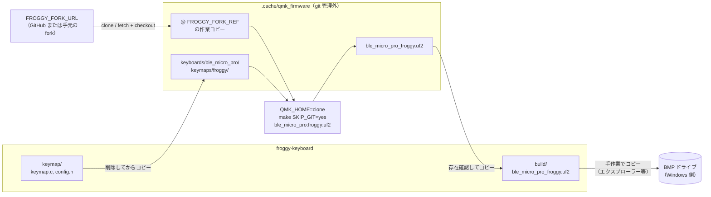
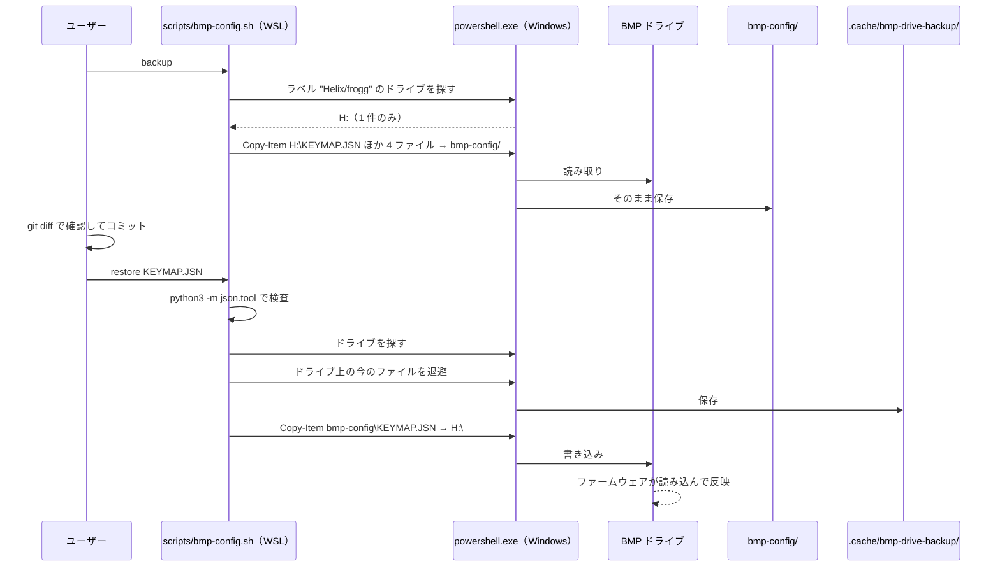

# froggy-keyboard 設計書

Froggy 片手キーボード（遊舎工房キット、Helix 系、左手組み）に BLE Micro Pro（BMP）を載せた個人用ファームウェア資産の設計書です。
このリポジトリの構成・ビルド・設定ファイル運用について、ここに書いたものが現在の正しい姿です。

## 1. 全体構成

### 1.1 リポジトリと役割

| リポジトリ | 役割 | このリポジトリからの扱い |
|---|---|---|
| `kinjoyuji/froggy-keyboard`（本リポジトリ） | 自分で書いた・調整した資産だけを持つ（キーマップ、BMP ドライブ上の設定ファイル、スクリプト、文書） | 正本 |
| `kinjoyuji/qmk_firmware`（BMP 対応 QMK の fork） | ビルド土台。sekigon-gonnoc の `dev/ble_micro_pro`（2023-07 時点、QMK 本体は 2021 年のもの）を元にしている | コミット `46b3074d6a4b31d05af124ddcfa539b6b8ff84aa` に固定し、読み取り専用で使う。変更しない |

fork を固定して使う理由と、採用しなかった案は [ADR 0001](adr/0001-separate-repo-with-pinned-fork.md) に書いています。

### 1.2 ディレクトリ構成（契約）

```
froggy-keyboard/
├── keymap/                 # fork の keyboards/ble_micro_pro/keymaps/froggy/ にそのまま入る
│   ├── keymap.c
│   └── config.h
├── bmp-config/             # BMP ドライブ上の設定ファイルのバックアップ（バイト単位でそのまま保存）
│   ├── KEYMAP.JSN
│   ├── CONFIG.JSN
│   ├── TAPTERM.JSN
│   ├── ENCODER.JSN
│   └── MACRO.TXT
├── scripts/
│   ├── bmp-config.sh       # bmp-config/ と BMP ドライブの間でバックアップ・書き戻しをする
│   └── keymap-table.py     # KEYMAP.JSN から README のキー配置一覧を作る
├── build.sh                # ファームウェア（.uf2）をビルドする
├── docs/
│   ├── design.md           # この文書
│   └── adr/
├── README.md               # 日本語。ビルド・書き込み・バックアップの手順
├── CLAUDE.md               # 英語。Claude Code 向けのハードウェア事実と作業ルール
├── LICENSE
├── .gitattributes          # bmp-config/* を -text（改行変換しない）
├── .gitignore              # .cache/ と build/
├── .cache/                 # （git 管理外）
│   ├── qmk_firmware/       #   ビルド用の fork の clone（build.sh 専用）
│   └── bmp-drive-backup/   #   書き戻し直前のドライブ上のファイル（bmp-config.sh が作る）
└── build/                  # （git 管理外）ビルド結果
```

守るべきルール:

- `keymap/` の中身が、ビルド時の `keymaps/froggy/` の中身のすべてです。`keymap/` にないファイルはビルドに入りません。
- `bmp-config/` のファイルは改行コードと文字コードを変えずに保存します。ドライブに書き戻したときにファームウェアがそのまま読み込めることが条件です。
- `VERSION.TXT`・`INDEX.HTM`・`MAP_EDIT.HTM` はファームウェアが自動で作るファイルなので、バックアップしません。

### 1.3 各部品の責任

| 部品 | 責任 | 持たないもの |
|---|---|---|
| `keymap/keymap.c` | 独自キーコードの定義と名前文字列表（`keycode_str_converter` が `KEYMAP.JSN` を読むときに使う）、`process_record_user` などの処理 | 実際に使われるキー配置（それは `KEYMAP.JSN`） |
| `keymap/config.h` | fork のキーボード設定（`keyboards/ble_micro_pro/config.h`）との差分と、タッピング設定 | 基板の配線・行列定義（fork 側） |
| `bmp-config/KEYMAP.JSN` | 実機で有効なキー配置。`keymap.c` のレイヤー定義より優先される | — |
| `bmp-config/CONFIG.JSN` | 実機の設定（左手組み、LED のピン `pin: 1` と個数 `num: 6`、JP 配列、デバイス名 `device_info.name` など） | — |
| `build.sh` | 固定した fork を用意し、`keymap/` を入れてビルドし、`.uf2` を `build/` に置く | 書き込み（ドライブへのコピーは手作業） |
| `scripts/bmp-config.sh` | BMP ドライブを探し、設定ファイルのバックアップと書き戻しをする | `.uf2` の書き込み |
| `scripts/keymap-table.py` | `bmp-config/KEYMAP.JSN` から README のキー配置一覧を作る | キー配置そのもの（それは `KEYMAP.JSN`） |

### 1.4 fork 側への依存

本リポジトリにコピーせず、固定した fork のコミットに含まれていることを前提にしているものです。

| 依存先（fork 内のパス） | 用途 |
|---|---|
| `quantum/keymap_extras/keymap_jp.h` | fork で独自に追加したキーコードのうち `JP_LT` / `JP_GT` を使う（`keymap.c` と `KEYMAP.JSN` の両方）。同じく追加された `JP_ZHTG` `JP_DQT` `JP_MEISU` `JP_MKANA` は、本リポジトリでは使っていない |
| `keyboards/ble_micro_pro/config.h` | 基板設定の土台。固定コミットでは `RGBLED_NUM_DEFAULT 128`。差分は `keymap/config.h` で上書きする |
| `tmk_core/protocol/nrf/` | BMP の USB・BLE 処理と、ドライブ上の JSON の読み込み。`bmp.c` は `DISABLE_MSC`（既定 0）で USB ドライブの有無を切り替える |

fork の固定コミットを変えるときは、この表の項目が新しいコミットにもあるかを確認します。

## 2. インターフェース

### 2.1 `build.sh`

```
./build.sh [-h|--help]
```

引数は help だけです。help に余分な引数を付けた場合や、それ以外の引数を渡した場合は終了コード 2 です。

| 環境変数 | 既定値 | 意味 |
|---|---|---|
| `FROGGY_FORK_URL` | `https://github.com/kinjoyuji/qmk_firmware.git` | fork の取得元。手元の fork のパス（例: `../qmk_firmware`）も指定でき、その場合は通信なしで速く取得できる |
| `FROGGY_FORK_REF` | `46b3074d6a4b31d05af124ddcfa539b6b8ff84aa` | ビルドに使う fork のコミット（40 桁の SHA） |

次の値は固定で、変更できません。

| 項目 | 値 |
|---|---|
| ビルド用 clone | `<repo>/.cache/qmk_firmware` |
| 目印ファイル | `<repo>/.cache/qmk_firmware/.git/froggy-cache` |
| 出力先 | `<repo>/build/ble_micro_pro_froggy.uf2` |

#### 2.1.1 処理の流れ

各手順は `|| die 1 "<理由>"` または `|| die 2 "<理由>"` で包み、失敗した手順と理由を表示して止めます。

1. 前提チェック（失敗は終了コード 2）:
   - `git`・`make`・`arm-none-eabi-gcc`・`qmk`・`python3` があること。
   - `FROGGY_FORK_REF` が小文字の 16 進数 40 文字であること（ブランチ名や短縮 SHA では固定にならないため）。
   - `FROGGY_FORK_URL` がローカルパスの場合は `realpath` で絶対パスにしてから、以降の clone・`set-url`・同一パス判定に使う。相対パスのまま `origin` に登録すると、clone の中から見て別の場所を指してしまうためです。
   - その実パスがビルド用 clone の実パスと同じでないこと。`file://` 形式でビルド用 clone を指している場合も同じ扱いにする。ユーザーの fork を `checkout --force` や `clean` で消さないための安全装置です。
2. clone の用意:
   - ビルド用 clone がなければ `git clone --no-checkout "$FROGGY_FORK_URL"` で作り、目印ファイルを作る（ローカルディレクトリ以外から取るときは `--filter=blob:none` を付けて取得量を減らす）。clone に失敗したら、途中までできたディレクトリを削除して終了コード 1。
   - ビルド用 clone があって目印ファイルがなければ、何も触らずに終了コード 2 で止める（`build.sh` が作った clone 以外を壊さないため）。この状態は、実行が途中で中断されたときや、ディレクトリを手で作ったときに起きる。メッセージでは `.cache/qmk_firmware` を削除してから再実行するよう案内する。
3. 固定コミットへの切り替え（失敗は終了コード 1）:
   - `git remote set-url origin "$FROGGY_FORK_URL"` で取得元を毎回合わせる（環境変数を変えたときに古い取得元を使わないため）。
   - `FROGGY_FORK_REF` が手元になければ、まず `git fetch origin "$FROGGY_FORK_REF"` でそのコミットだけを取り、取れなければ `git fetch origin` で全体を取る（SHA を指定した取得を受け付けない取得元があるため）。
   - `git checkout --force --detach "$FROGGY_FORK_REF"` と `git clean -fdx -e .build` で、固定コミットのきれいな状態に戻す。`.build/` は再ビルドを速くするために残す。
4. キーマップの差し込み: `keyboards/ble_micro_pro/keymaps/froggy/` を削除してから `keymap/` の中身をコピーする（fork 側にだけあるファイルを残さないため）。
5. ビルド: clone の中で、`QMK_HOME` をビルド用 clone に向けて `make SKIP_GIT=yes ble_micro_pro:froggy:uf2` を実行する。`qmk` CLI が別の場所の QMK（ユーザーの設定にある `QMK_HOME`）を読まないようにするためです。失敗は終了コード 1。
6. 成果物の回収: clone 直下に `ble_micro_pro_froggy.uf2` があることを確かめてから（`make` が 0 で終わってもファイルがなければ終了コード 1）、`build/` にコピーする。そのパスを標準出力の最後の行に出す。

`set -euo pipefail` で動かします。ユーザーの既存の fork 作業コピーには一切書き込みません（ローカルパスから clone する場合も、git は元のリポジトリを読むだけです）。

#### 2.1.2 サブモジュールと `SKIP_GIT`

- 固定コミットを checkout すると、サブモジュールの場所（`lib/chibios` など）は空のディレクトリとして作られます。fork の `Makefile` は「ディレクトリがない」ときだけサブモジュールを取得する（`[ ! -e lib/chibios ]`）ので、`build.sh` がサブモジュールを取得することはありません。
- BMP（nRF52）のビルドは `lib/` のサブモジュールのソースを使いません。printf も `tmk_core/common/nrf/printf.c` を使います。この前提で、ビルドはサブモジュールなしで行います。
- この前提が崩れた場合は、`build.sh` に `git submodule update --init --depth 1 lib/<name>` を必要なものだけ明示的に足します。
- `SKIP_GIT=yes` は次の 3 つを飛ばします。空のサブモジュールが「dirty」と警告される無駄な出力もなくなります。
  - `Makefile` 23 行の、`git describe` による `QMK_VERSION` の取得
  - `Makefile` のサブモジュールの取得・状態確認のブロック
  - `qmk generate-version-h` の中の git 呼び出し（`--skip-git`）
- `tmk_core/nrf.mk` 40 行の `GIT_DESCRIBE` は `SKIP_GIT` に関係なく `git describe` を実行します。fork にタグがないので `fatal: No names found` が何度か表示されますが、ビルドには影響しません。

#### 2.1.3 終了コード

| コード | 意味 |
|---|---|
| 0 | 成功。`build/ble_micro_pro_froggy.uf2` ができている |
| 1 | 実行中の失敗（fork の取得・checkout、`make`、成果物のコピー、`.uf2` がない） |
| 2 | 使い方の誤り、または前提を満たしていない（引数の誤り、必要なコマンドがない、`FROGGY_FORK_REF` の形式が違う、目印ファイルがない、取得元と clone 先が同じ） |

### 2.2 `keymap/config.h`

QMK は、キーボードの `config.h` の**後に**キーマップの `config.h` を読み込みます。このため、キーボード設定の値はキーマップ側で `#undef` してから定義し直せば上書きできます。根拠は ADR 0001 の「背景」に書いています。

`keymap/config.h` に入れる、キーボード設定との差分:

| マクロ | fork の値 | 本リポジトリでの値 | 書き方 |
|---|---|---|---|
| `RGBLED_NUM` | 128（`tmk_core/nrf.mk` 31 行の `-DRGBLED_NUM=128` と、`keyboards/ble_micro_pro/config.h` 84 行の両方） | 6 | `#undef` してから `#define`（コマンドラインの定義を上書きするため） |
| `RGBLED_NUM_DEFAULT` | 128（`keyboards/ble_micro_pro/config.h`） | 6 | `#undef` してから `#define` |

この 2 つのほかに、ワンショット設定（`ONESHOT_TAP_TOGGLE 5`、`ONESHOT_TIMEOUT 5000`）を持ちます。`TAPPING_TERM` はキーボード設定の 200 をそのまま使います。

RGB エフェクトは、キーボード設定にある `RGBLIGHT_ANIMATIONS` によって、後から読み込まれる `quantum/rgblight/rgblight.h` ですべて有効になります。そのため個々の `#undef RGBLIGHT_EFFECT_*` は効かず、`keymap/config.h` には入れません。エフェクトを減らすときは、`keymap/config.h` で `#undef RGBLIGHT_ANIMATIONS` したうえで、使う `RGBLIGHT_EFFECT_*` だけを `#define` します。

### 2.3 USB 有線で BIOS/UEFI から使う

BMP は USB 接続時、キーボードと USB ドライブを 1 つの機器として見せます。実機（PC 1 台）では、この通常版のまま USB 接続で BIOS に入れることを確かめています。BIOS に入るキー（例: `F2`）は、レイヤー4 の `設定(1回)` を押してからレイヤー2 で押します。

BIOS/UEFI がこの組み合わせを受け付けない PC では、`keymap/config.h` に `#define DISABLE_MSC 1` を足して froggy をビルドします（別のキーマップ `no_msc` は使いません。froggy の独自キーコードや処理を残すためです）。

| 得るもの | 失うもの |
|---|---|
| USB ドライブなしの、キーボードだけの機器になる | ドライブが出なくなるので、`bmp-config.sh` のバックアップ・書き戻しと JSN の編集ができない |

このため、JSN の変更とバックアップは `DISABLE_MSC` 版を書き込む**前に**済ませます。ドライブが必要になったときは、ブートローダーのドライブから通常版の `.uf2` を書き込んで戻します。この設定は、実機の BIOS/UEFI で通常版が認識されない場合にだけ使います。

### 2.4 `scripts/bmp-config.sh`

```
scripts/bmp-config.sh [-h|--help]
scripts/bmp-config.sh locate
scripts/bmp-config.sh backup
scripts/bmp-config.sh restore [--yes] FILE [FILE...]
```

help に余分な引数を付けた場合は終了コード 2 です。起動直後に `python3`・`powershell.exe`・`wslpath`・`timeout` があることを確かめ、なければ終了コード 2 で止めます。

| サブコマンド | 動作 |
|---|---|
| `locate` | BMP ドライブのドライブ文字（例: `H:`）を表示する |
| `backup` | ドライブから 5 ファイル（`KEYMAP.JSN` `CONFIG.JSN` `TAPTERM.JSN` `ENCODER.JSN` `MACRO.TXT`）を `bmp-config/` にコピーする。ドライブにないファイルは警告を出して飛ばす |
| `restore [--yes] FILE...` | 指定したファイルだけを `bmp-config/` からドライブにコピーする。ファイル名の指定は必須（全部まとめて上書きする事故を防ぐため）。指定できるのは上の 5 つのファイル名だけで、`/` を含む指定は終了コード 2。コピーした時点でファームウェアが内容を読み込む |

| 環境変数 | 既定値 | 意味 |
|---|---|---|
| `FROGGY_BMP_DRIVE` | （なし） | 指定するとラベル検索をせず、このドライブ文字を使う。`H:` の形式で、そのドライブが存在し、BMP の目印として `VERSION.TXT` があること。満たさなければ終了コード 2 |

#### 2.4.1 ドライブの探し方

- ボリュームラベルは `CONFIG.JSN` の `device_info.name` の先頭 11 文字です（FAT のラベルの長さの上限）。このキーボードでは `Helix/frogg` で、スクリプトに固定値として持ちます。
- この対応は、ソース非公開の BMPAPI の動きを実機で観察したものです（`name` が `Helix/froggy` のとき、ラベルが `Helix/frogg` になることを確認済み）。BMP のファームウェア（ブートローダー・BMPAPI）を更新したときは、改めて確認します。
- 探す処理は PowerShell の中で完結させます。

  ```
  Get-CimInstance Win32_LogicalDisk -Filter "DriveType=2" | ? VolumeName -eq 'Helix/frogg' | % DeviceID
  ```

  出力はドライブ文字（`DeviceID`）だけにし、bash 側で末尾の `\r` を取り除きます。
- 見つかったのがちょうど 1 つのときだけ使います。0 個または 2 個以上なら、リムーバブルドライブの一覧（ドライブ文字とラベル）を表示して終了コード 2 で止めます。
- `device_info.name` を変えた `CONFIG.JSN` を書き戻すとラベルが変わり、次からは見つからなくなります。その場合は `FROGGY_BMP_DRIVE` で指定します。指定したドライブは、形式（`X:`）・存在・`VERSION.TXT` の有無を確かめてから使います（BMP 以外のドライブに書き込まないため）。

#### 2.4.2 書き戻しの安全策

`restore` はドライブに書く前に、次の順で確認します。1 つでも満たさなければ、何も書かずに止めます。

1. `.JSN` ファイルが JSON として正しいこと（`python3 -m json.tool FILE > /dev/null`）。壊れた JSON を書くと、ファームウェアが設定を読めなくなるためです。
2. 書き戻す対象のファイル（`restore` で指定したもの）のうち、ドライブ上にあるものを `.cache/bmp-drive-backup/<日時>/` に退避すること。ドライブにないファイルは飛ばします（書き戻しで失った設定を取り戻せるようにするため）。
3. `CONFIG.JSN` が含まれる場合は、確認の入力を求めること（`--yes` で省略できる）。`CONFIG.JSN` はピン配置やデバイス名を変え、間違えるとキーが効かなくなったりドライブのラベルが変わったりするためです。

#### 2.4.3 PowerShell の呼び出し方

- WSL2 では BMP ドライブが `/mnt` に自動ではマウントされず、手動でマウントするには sudo が要ります。そのため、ドライブの操作はすべて `powershell.exe` で行います。
- 呼び出しの決まり:
  - `powershell.exe -NoProfile -NonInteractive -Command` で起動し、スクリプトの先頭で `$ErrorActionPreference='Stop'` にする（途中のエラーで確実に止めるため）。
  - 標準入力は `</dev/null` にする。こうしないと、`powershell.exe` が端末の入力を読み取ってしまい、`CONFIG.JSN` の確認への答えが消えるためです。
  - `timeout 60` で包む。時間切れは終了コード 1。
  - 出力の文字コードは UTF-8 にする（ラベルやパスの文字化けを防ぐため）。
  - PowerShell が途中で失敗した場合も、それまでに出たファイルごとの結果の行を表示してから終了コード 1 で止める（どこまでコピーできたかが分かるようにするため）。
- コピーには `Copy-Item -LiteralPath '<元>' -Destination '<先>'` を使います。リポジトリ側のパスは `wslpath -w` で Windows 形式にし、パスの中の `'` は `''` にして渡します。`Get-Content` は文字コードや改行が変わることがあるので使いません。
- `powershell.exe` は作業ディレクトリを `/mnt/c` にして起動します。WSL 側のディレクトリ（UNC パス）から起動したときに出る警告を避けるためです。
- 終了コード: 0 = 成功、1 = コピーの失敗・時間切れ、2 = 使い方の誤りまたは前提を満たしていない（必要なコマンドがない、ファイル名が正しくない、ドライブが見つからない・複数ある・BMP ではない、JSON が正しくない、確認で中止した）。

#### 2.4.4 スクリプトにする理由

ドライブ探し・パス変換・改行の保持を毎回手で正しくやるのは間違えやすく、バックアップは繰り返し行う作業だからです。

### 2.5 `scripts/keymap-table.py`

```
scripts/keymap-table.py [--check]
```

- `bmp-config/KEYMAP.JSN` を読み、レイヤーごとのキー配置表（Markdown）を作って、`README.md` の `<!-- keymap:begin -->` と `<!-- keymap:end -->` の間を置き換えます。区間の外は変えません。
- `--check` のときは書き換えず、README の表が `KEYMAP.JSN` と一致していれば終了コード 0、ずれていれば 1 を返します。
- 表は実機の並び（上から 6・6・6・7・7 キー、最下段が親指）で描きます。キー数の合計がレイヤーのキー数と合わないとき、または区間の目印が見つからないときは終了コード 2 で止めます。
- キーコードは、記号・日本語の短い名前に置き換えて表示します（例: `JP_LPRN` → `(`、`KC_BTN1` → `左クリック`）。置き換え表にないキーコードは、`KC_` を外した元の名前のまま表示します。レイヤーの名前と説明もスクリプトが持ちます。`KEYMAP.JSN` にはそれらが入っていないためです。
- 理由: 表を README に手で書くと、`KEYMAP.JSN` を変えたときに更新を忘れてずれるため、`KEYMAP.JSN` から作ります。

### 2.6 README.md の構成（日本語）

1. このリポジトリについて（何が入っているか。ファームウェア本体は fork を固定して使うこと）
2. 必要なもの（WSL2、`arm-none-eabi-gcc`、`qmk` CLI、`python3`、`git`、`make`）
3. ビルド（`./build.sh`、環境変数の表、成果物の場所）
4. 書き込み（`build/ble_micro_pro_froggy.uf2` を BMP のドライブにコピーする。WSL の `nrfutil` は使えない）
5. 設定ファイルのバックアップと書き戻し（`scripts/bmp-config.sh`、`CONFIG.JSN` の注意）
6. キー配置一覧（`scripts/keymap-table.py` が作る区間。手で編集しない）
7. キー配置の変え方（実機で使われるのは `KEYMAP.JSN`。`keymap.c` を変えるのは独自キーコードや処理を増やすときだけ）
8. BIOS/UEFI で使う（通常版で動作確認済み、`F2` などの押し方、受け付けない PC 向けの代替設定。2.3 の要点）
9. ライセンス

### 2.7 CLAUDE.md の構成（英語）

1. What this repo is: personal assets only; the firmware base is the pinned fork (`FROGGY_FORK_REF`), which must not be edited from here.
2. Layout and build: `keymap/` is copied into the fork's `keymaps/froggy/`; `./build.sh`; output in `build/`.
3. Hardware facts:
   - The active keymap is `KEYMAP.JSN` on the BMP drive, not the layers in `keymap.c`. `keymap.c` still matters for custom keycodes (name string table) and `process_record_user`.
   - LED data pin is 1 (= Pro Micro D3), 6 LEDs, from `CONFIG.JSN`.
   - LED power comes from BMP pin 21 (~4.3V), so LEDs can light only while USB is connected. On Helix-type PCBs, pins 21 and 24 are shorted; this hardware issue keeps the LEDs dark.
   - No OLED is mounted.
4. USB in BIOS/UEFI: the normal build works (verified on one PC; BIOS keys such as `F2` are on layer 2 via `OSL(2)`). If a PC rejects the composite device (HID + mass storage) is rejected, add `#define DISABLE_MSC 1` to `keymap/config.h`; the drive then disappears, so edit/back up JSN files before flashing that build.
5. BMP drive access from WSL2: it is not auto-mounted under `/mnt` and mounting needs sudo; use `powershell.exe` (see `scripts/bmp-config.sh`). Read-only unless the user asks to restore or flash.
6. Pointers to `docs/design.md` and `docs/adr/`.

### 2.8 ライセンス

リポジトリ全体（スクリプトと設定ファイルを含む）を GPL-2.0-or-later とし、`LICENSE` に GPL-2.0 の全文を置きます。`keymap.c` と `config.h` は QMK 由来でファイル先頭に GPL-2.0-or-later と書かれているので、それに合わせ、ファイルごとにライセンスが違う状態を避けます。

## 3. データの流れ

### 3.1 ビルドと書き込み



### 3.2 設定ファイルのバックアップと書き戻し



## 4. 受け入れ条件

| 対象 | 条件 |
|---|---|
| `build.sh` | `.cache/` がない状態から 0 で終わり、`build/ble_micro_pro_froggy.uf2` ができる。2 回目も 0 で終わる。手元の fork（例: `../qmk_firmware`）の `git status` が実行の前後で同じ |
| `build.sh` の安全装置 | 目印ファイルのない `.cache/qmk_firmware` があると、何も変えずに 2 で終わる。`FROGGY_FORK_URL` が clone 先と同じ場所を指すと 2 で終わる |
| `bmp-config.sh backup` | ドライブの 5 ファイルとバイト単位で一致する（`Get-FileHash` と `sha256sum` で比べる） |
| `bmp-config.sh restore` | 壊れた JSON を渡すと何も書かずに 2 で終わる。書き込む前に `.cache/bmp-drive-backup/` に今のファイルが残る。`CONFIG.JSN` を含むと確認を求める |
| `keymap-table.py` | 実行後に `--check` が 0 で終わる。区間の外の README は変わらない |

## 5. 決定事項

| # | 決定 | 理由 | 詳細 |
|---|---|---|---|
| D1 | 個人資産だけを持つ別リポジトリにし、fork は固定して読み取り専用で使う | fork は QMK 全体を含み、自分の資産がどれか分かりにくい。このリポジトリからは上流の更新を取り込まないので、固定して困ることがない | [ADR 0001](adr/0001-separate-repo-with-pinned-fork.md) |
| D2 | 固定コミットは `46b3074d6` で、キーボード設定との差分は `keymap/config.h` が持つ | 実機に書き込まれているファームウェアの設定（LED 6 個）を、fork を変えずに再現するため | ADR 0001 |
| D3 | ビルドは `build.sh` 専用の clone（`.cache/qmk_firmware`、目印ファイル付き）で行う | `make` は `quantum/version.h`・`.build/`・`*.uf2` を作業コピーに書く。worktree は元の `.git` に書き込む。clone なら別のマシンでも同じ手順で再現できる | ADR 0001 |
| D4 | サブモジュールは取得せず、`SKIP_GIT=yes` でビルドする | nRF のビルドはサブモジュールを使わない。`SKIP_GIT` で `Makefile` の `git describe`・サブモジュール確認と `generate-version-h` の git 呼び出しを省く（`nrf.mk` の `GIT_DESCRIBE` は残るが無害） | 2.1.2 |
| D5 | RGB エフェクトの個別 `#undef` は持たない | `RGBLIGHT_ANIMATIONS` があるため効かない | 2.2 |
| D6 | BIOS/UEFI 向けの代替は froggy に `DISABLE_MSC 1` を足すことで行う | froggy の独自キーコードと処理を残すため | 2.3 |
| D7 | 設定ファイルのバックアップ・書き戻しはスクリプトにし、`.uf2` の書き込みは手作業にする | バックアップは繰り返し行い、手でやると間違えやすい。書き込みはたまにしか行わない | 2.4 |
| D8 | ライセンスはリポジトリ全体で GPL-2.0-or-later にする | 元にした QMK 由来ファイルのライセンスに合わせ、ファイルごとの違いをなくす | 2.8 |
